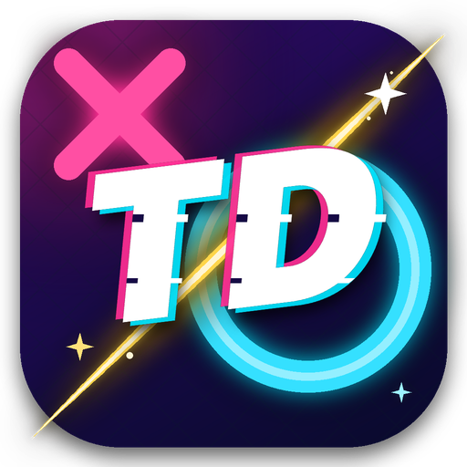

<p align="center">
  
</p>

<h1 align="center">TDCaro</h1>

<p align="center">
  Game Caro (Gomoku – nối 5) đấu với máy, có 4 mức độ AI từ <b>Dễ</b> đến <b>Cực khó</b>.<br>
  Đồ án môn Trí tuệ Nhân tạo – viết bằng Python + pygame-ce.
</p>

<p align="center">
  <a href="https://github.com/DuyDev1205/TDCaro/releases/latest"><b>⬇ Tải bản mới nhất (Windows .exe / macOS .dmg)</b></a>
</p>

---

## Tính năng

- **4 mức độ AI**: Dễ · Bình thường · Khó · Cực khó (xem chi tiết bên dưới)
- Bàn cờ từ 5×5 đến 15×15, chọn người đi trước
- 4 giao diện: Midnight Neon, Gỗ Cổ Điển, Đại Dương, Hoa Anh Đào
- Hiệu ứng đặt quân, đường thắng, pháo giấy; âm thanh
- **Đi lại** (Undo), **Gợi ý** nước đi, lịch sử nước đi, đồng hồ, tỉ số
- AI chạy trên luồng riêng → giao diện không bị đơ
- **Tự động cập nhật**: game tự kiểm tra bản mới trên GitHub Releases và cập nhật bằng một cú bấm

## Cài đặt

| Hệ điều hành | Tệp | Ghi chú |
|---|---|---|
| Windows 10/11 | `TDCaro-vX.Y.Z-Windows.exe` | Chạy trực tiếp. Nếu SmartScreen cảnh báo: *More info → Run anyway* |
| macOS (M1/M2/M3…) | `TDCaro-vX.Y.Z-macOS-AppleSilicon.dmg` | Mở .dmg, kéo **TDCaro** vào Applications |
| macOS (Intel) | `TDCaro-vX.Y.Z-macOS-Intel.dmg` | như trên |

> **macOS:** ứng dụng chưa được ký bởi Apple, lần đầu mở hãy **chuột phải → Open**.
> Nếu báo "app is damaged", chạy: `xattr -cr "/Applications/TDCaro.app"`

## Phím tắt

| Phím | Chức năng |
|---|---|
| `Space` / `Enter` | Bắt đầu / ván mới |
| `←` `→` | Đổi kích thước bàn (menu) |
| `D` | Đổi độ khó (menu) |
| `F` | Đổi người đi trước (menu) |
| `U` / `Ctrl+Z` | Đi lại |
| `H` | Gợi ý |
| `T` | Đổi giao diện |
| `M` | Bật/tắt âm thanh |
| `Esc` | Về menu / thoát |

## Các mức độ AI

| Mức | Thuật toán |
|---|---|
| **Dễ** | Thuật toán **gốc** của đồ án (`best_move` / `stupid_score`): tham lam 1 nước, chấm điểm tấn công + phòng thủ theo các cửa sổ 5 ô. |
| **Bình thường** | Vẫn dùng hàm chấm điểm gốc, thêm **luật ưu tiên** (thắng ngay › chặn 5 › tạo bốn mở › chặn ba mở), khai cuộc ở tâm và kiểm tra để không đi nước khiến đối thủ có chuỗi "bốn" ép thắng (VCF). |
| **Khó** | Đánh giá theo **mẫu hình** (năm, bốn mở, bốn, ba mở, ba, hai…), tìm chuỗi ép thắng **VCF**, lọc nước nguy hiểm, **Minimax + cắt tỉa Alpha-Beta** sâu ~6 nước với beam search. |
| **Cực khó** | Như Khó + tìm chuỗi đe dọa **VCT** (ba/bốn liên tiếp), chủ động phá VCF/VCT của người chơi, **đào sâu dần** (iterative deepening) tới 12 nước, **bảng chuyển vị Zobrist**, suy nghĩ khoảng 2 giây/nước (Khó: ~0,8 giây). |

Mã nguồn AI gốc nằm nguyên vẹn trong [`src/Finals.py`](src/Finals.py); các mức mới nằm trong [`src/ai_engine_v2.py`](src/ai_engine_v2.py).

### So sánh sức mạnh (AI đấu AI, bàn 15×15)

| Trận (10 ván, đổi lượt đi trước) | Thắng | Thua | Hòa |
|---|:-:|:-:|:-:|
| Bình thường vs Dễ | 2 | 0 | 8 |
| Khó vs Dễ | 9 | 1 | 0 |
| Khó vs Bình thường | 7 | 3 | 0 |

Chạy lại: `python tools/benchmark.py 10 15`

## Chạy từ mã nguồn

```bash
python -m venv .venv
.venv\Scripts\activate          # macOS/Linux: source .venv/bin/activate
pip install -r requirements.txt
python src/Finals.py
```

## Build

- **Windows:** chạy `packaginguild_exe.bat` → `dist/TDCaro.exe`
- **macOS:** `pyinstaller packaging/TDCaro_mac.spec` → `dist/TDCaro.app`
- **Tự động:** push một tag dạng `v1.2.3` → GitHub Actions build `.exe` + `.dmg` và đăng lên Releases.

## Cấu trúc

```
src/
  Finals.py           Giao diện pygame-ce + AI gốc (mức Dễ) — chạy file này
  ai_engine_v2.py     AI nâng cao (Bình thường / Khó / Cực khó)
  updater.py          Tự động cập nhật qua GitHub Releases
assets/               Icon (.ico / .png)
packaging/            Cấu hình PyInstaller (Windows / macOS) + build_exe.bat
tools/
  benchmark.py        Cho các mức AI đấu nhau
  set_version.py      Ghi số phiên bản (dùng trong CI)
.github/workflows/    CI build & release (.exe + .dmg)
```
